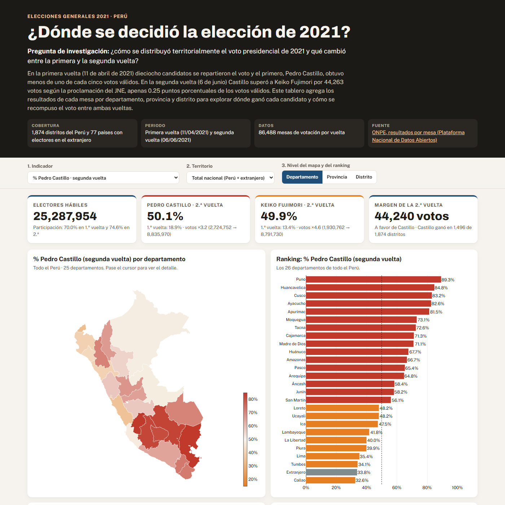
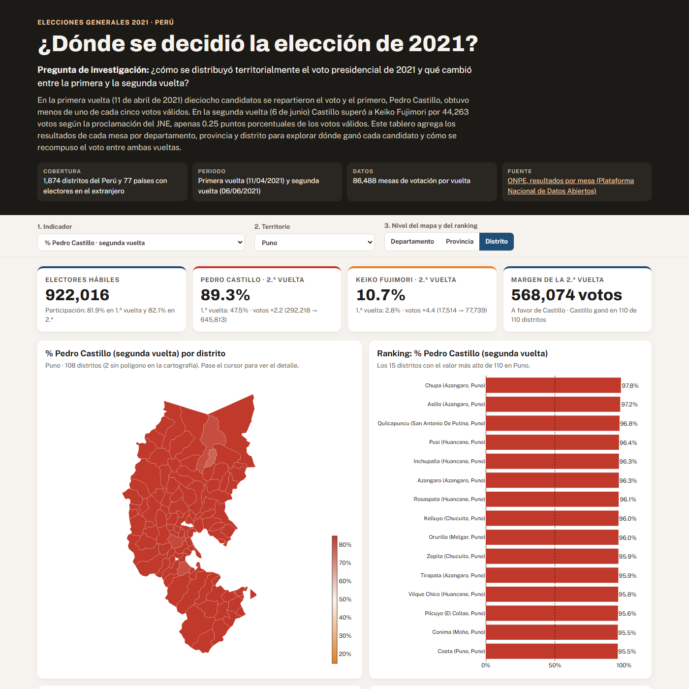
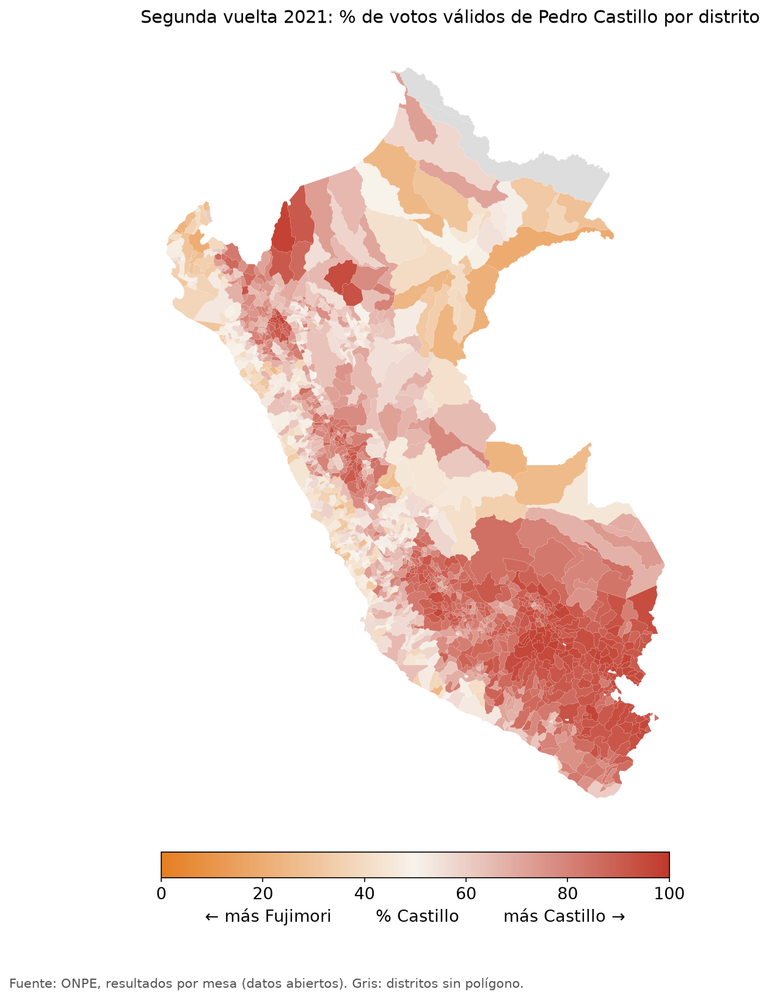
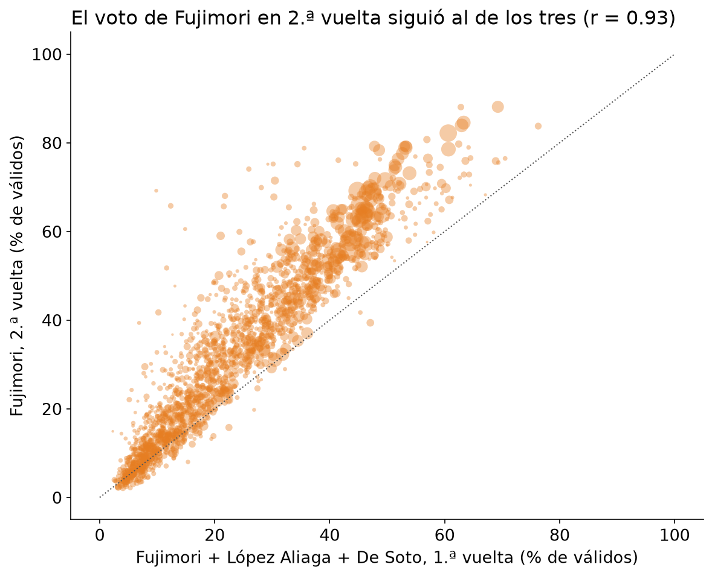
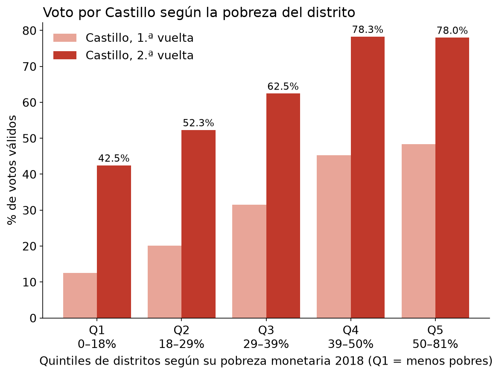

# ¿Dónde se decidió la elección de 2021? El voto territorial en la primera y la segunda vuelta presidencial

**Tarea 3** del curso Python Intermedio para Ciencias Sociales y Gestión Pública (Diplomatura de Especialización en
Ciencia de Datos, Q-LAB PUCP) · **Autor:** Frank Pinares Gutiérrez

| Producto | Enlace |
|---|---|
| Dashboard público e interactivo | **https://saffron29.github.io/tarea_3/** |
| Reel de divulgación (67 s, 1080 × 1920) | [`reel/reel.mp4`](reel/reel.mp4) |
| Reel en línea (en lugar de LinkedIn, ver la sección 6) | **https://saffron29.github.io/tarea_3/reel.mp4** |
| Repositorio | https://github.com/saffron29/tarea_3 |



## 1. Tema y pregunta de investigación

El presente trabajo analiza la distribución territorial del voto en la elección presidencial peruana de 2021, en la
cual Pedro Castillo (Perú Libre) se impuso a Keiko Fujimori (Fuerza Popular) por 44,263 votos según la proclamación del
Jurado Nacional de Elecciones. Siguiendo esto, la pregunta que orienta el análisis es la siguiente:

> **¿Cómo se distribuyó territorialmente el voto presidencial de 2021 y qué cambió entre la primera y la segunda vuelta?**

La cobertura geográfica comprende los 1,874 distritos del Perú y los 77 países en los que votaron los peruanos residentes
en el extranjero, mientras que la cobertura temporal corresponde a la primera vuelta (11 de abril de 2021) y a la
segunda vuelta (6 de junio de 2021).

## 2. Descripción del proyecto

El proyecto parte de los resultados oficiales **mesa por mesa** de la ONPE (86,488 mesas en cada vuelta), los cuales se
limpian, se agregan por distrito, provincia y departamento, y se cruzan con la pobreza monetaria distrital del INEI. A
partir de ello se construyen dos productos complementarios. Por una parte, un **dashboard** publicado en GitHub Pages,
con cuatro indicadores clave, cuatro visualizaciones (un mapa coroplético, un ranking, una dispersión entre pobreza y
voto, y la composición del voto de la primera vuelta) y tres controles interactivos: el indicador, el territorio y el
nivel territorial. Por otra parte, un **reel** vertical de 67 segundos que narra los hallazgos con una voz generada por
inteligencia artificial a partir de la voz del autor, acompañada de mapas, gráficos, música y subtítulos.



## 3. Fuentes de datos y metodología

### Fuentes

| Dato | Fuente | Uso |
|---|---|---|
| Resultados por mesa, primera vuelta | ONPE, [Elecciones Generales 2021](https://www.datosabiertos.gob.pe/dataset/resultados-por-mesa-de-las-elecciones-generales-2021-oficina-nacional-de-procesos) (Plataforma Nacional de Datos Abiertos), con su diccionario | Votos de los 18 candidatos, blancos, nulos, votantes y electores |
| Resultados por mesa, segunda vuelta | ONPE, [Segunda Elección Presidencial 2021](https://www.datosabiertos.gob.pe/dataset/resultados-por-mesa-de-la-segunda-elecci%C3%B3n-presidencial-2021-oficina-nacional-de-procesos), con su diccionario | Votos de Castillo y Fujimori, blancos, nulos, votantes y electores |
| Resultado proclamado | JNE, Acta General de Proclamación (Resolución N.° 0750-2021-JNE), según [Andina](https://andina.pe/Agencia/noticia-jne-oficializa-proclamacion-pedro-castillo-como-presidente-electo-853973.aspx) | Validación de los totales |
| Equivalencia de ubigeos RENIEC–INEI, pobreza monetaria distrital 2018 (INEI) e IDH 2019 (PNUD) | [ubigeo-peru-aumentado](https://github.com/jmcastagnetto/ubigeo-peru-aumentado) (licencia MIT), que compila datos de CEPLAN, INEI y PNUD | Unión con los mapas y análisis de pobreza |
| Pobreza departamental 2020 | INEI, sumaria de la ENAHO 2020 ([microdatos](https://proyectos.inei.gob.pe/microdatos/), módulo 34) | Contexto departamental, con el método de la Clase 8 |
| Límites departamentales, provinciales y distritales | [peru-geojson](https://github.com/juaneladio/peru-geojson); los departamentales y distritales son los del laboratorio de la sesión 06 del curso | Mapas |

Todas las fuentes se descargaron el 31 de octubre de 2026 con `scripts/obtener_datos.py`. Debe tenerse en cuenta que el
portal de datos abiertos rechaza las descargas que no se identifican como un navegador, razón por la cual el script
envía un `User-Agent` de navegador.

### Metodología

El procesamiento se organizó en cuatro scripts que se ejecutan en orden. En primer lugar, `obtener_datos.py` descarga
las fuentes en `datos/originales/`. En segundo lugar, `procesar_datos.py` lee las mesas de ambas vueltas como texto, para
no perder los ceros iniciales del ubigeo, y aplica controles de calidad: no se encontraron mesas duplicadas, mesas con
más votantes que electores hábiles ni mesas en las que la suma de votos difiriera del número de votantes. Asimismo, se
resolvieron tres problemas de los datos: las celdas vacías de los conteos, que equivalen a cero votos; la letra «Ñ»
dañada en la base de la segunda vuelta, que aparece como «¿¿» en 43 nombres de lugares y 2,814 mesas (por ejemplo,
«ESPA¿¿A» o «CA¿¿ETE») y que impedía unir ambas vueltas en el extranjero; y el ubigeo de la ONPE, que corresponde a la codificación
de RENIEC y no a la del INEI (San Juan de Lurigancho es 140137 para la ONPE y 150132 para el INEI), por lo que se
convirtió con la tabla de equivalencias para unir los resultados con los mapas y con la pobreza distrital. Los 1,874
distritos encontraron su equivalencia. Por otra parte, el voto en el extranjero se agregó por país, dado que 18 mesas de
Venezuela cambian de ciudad entre una vuelta y otra.

En tercer lugar, `analizar_datos.py` calcula los indicadores por departamento, provincia y distrito. Siguiendo la
convención de la ONPE, el porcentaje de cada candidato se calcula sobre los **votos válidos**; la participación, sobre
los electores hábiles; y los votos en blanco y nulos, sobre los votos emitidos. La relación entre la pobreza y el voto
se mide con la correlación de Pearson entre distritos y con quintiles de distritos según su pobreza monetaria de 2018.
Finalmente, `exportar_web.py` prepara los datos del dashboard, el cual repite en JavaScript las mismas fórmulas; se
comprobó que los indicadores de la página coinciden con los calculados en Python.

La validación contra las cifras oficiales fue la siguiente:

| Cifra | Base procesada | Cifra oficial | Diferencia |
|---|---|---|---|
| Castillo, primera vuelta | 2,724,752 (18.921%) | ONPE: 2,724,752 (18.921%) | 0 |
| Fujimori, primera vuelta | 1,930,762 (13.407%) | ONPE: 1,930,762 (13.407%) | 0 |
| Castillo, segunda vuelta | 8,835,970 (50.125%) | JNE: 8,836,380 (50.126%) | −410 |
| Fujimori, segunda vuelta | 8,791,730 (49.875%) | JNE: 8,792,117 (49.874%) | −387 |
| Electores hábiles | 25,287,954 | — | — |
| Pobreza ENAHO 2020 (sumaria, `factor07 × mieperho`) | 30.1% | INEI: 30.1% | 0 |

La primera vuelta coincide exactamente con el resultado oficial. En cambio, la segunda vuelta difiere en 797 votos
válidos (0.005%), lo cual se explica porque la base abierta conserva 20 actas en estado «EN PROCESO». El detalle de
estos controles se encuentra en [`datos/procesados/validacion.txt`](datos/procesados/validacion.txt).

## 4. Hallazgos principales

**Hallazgo 1. Un país partido en dos.** En la segunda vuelta, Castillo ganó en 16 de los 25 departamentos y en 1,496 de
los 1,874 distritos (80%), alcanzando su máximo en Puno, con el 89.3% de los votos válidos. Fujimori, por su parte, se
impuso en Lima (64.6%), el Callao (67.4%), la costa norte (Tumbes, Piura, Lambayeque y La Libertad), Ica, Loreto y
Ucayali. Ahora bien, el resultado final no se explica solo por el territorio nacional: dentro del Perú, Castillo obtuvo
152,157 votos más que Fujimori, pero el voto en el extranjero, donde Fujimori alcanzó el 66.2%, redujo esa ventaja en
107,917 votos.



**Hallazgo 2. Cómo se recompuso el voto entre vueltas.** En una primera vuelta con 18 candidatos, Castillo ganó con
apenas el 18.9% de los votos válidos y Fujimori quedó segunda con el 13.4%. Entre ambas vueltas, Castillo multiplicó sus
votos por 3.2 (de 2.72 a 8.84 millones) y Fujimori por 4.6 (de 1.93 a 8.79 millones). En ese sentido, el porcentaje de
Fujimori en la segunda vuelta sigue casi exactamente, distrito por distrito, a la suma de los porcentajes de Fujimori,
López Aliaga y De Soto en la primera (r = 0.93); es decir, Fujimori creció precisamente donde estos tres candidatos
habían sido fuertes. Asimismo, los votos en blanco se redujeron de 12.4% a 0.6% de los votos emitidos y la
participación aumentó de 70.0% a 74.6%.



**Hallazgo 3. A más pobreza, más voto por Castillo.** En el 20% de distritos más pobres (pobreza monetaria de 2018 igual
o superior a 49.5%), Castillo obtuvo el 78.0% de los votos válidos de la segunda vuelta, mientras que en el 20% menos
pobre (hasta 18.3%) obtuvo el 42.5%. La correlación entre la pobreza del distrito y su voto por Castillo es de 0.44 y la
correlación con la altitud del distrito es aún mayor (0.59), lo cual es consistente con la concentración de
su voto en la sierra sur. Debe considerarse, sin embargo, que se trata de una asociación entre territorios y no de una
prueba de cómo votó cada persona.



## 5. Limitaciones del análisis

La principal limitación es la **falacia ecológica**: que los distritos más pobres votaran en mayor proporción por
Castillo no permite afirmar que las personas pobres lo hicieran, pues los datos son agregados y no individuales.
Asimismo, la pobreza distrital corresponde a 2018 y la elección a 2021, de modo que no recoge el aumento de la pobreza
durante la pandemia (30.1% en 2020 según la ENAHO); por ello, a nivel departamental, la correlación entre la pobreza de
2020 y el voto por Castillo es más débil (0.34), dado que departamentos con pobreza alta, como el Callao y Piura
(35.0%), Loreto (33.1%) o Tumbes (32.6%), votaron mayoritariamente por Fujimori, mientras que otros con pobreza baja,
como Moquegua (18.2%) o Madre de Dios (11.3%), lo hicieron por Castillo. Por otra parte, la base abierta de la segunda vuelta no coincide exactamente con el resultado
proclamado (797 votos válidos de diferencia), 48 distritos que representan el 2.0% de los electores no tienen polígono en
la cartografía del curso (fueron creados después de ella o tienen la geometría vacía) y, por tanto, no se pintan en el
mapa distrital, aunque sí cuentan en todas las cifras. Finalmente, la participación se calcula sobre todas las mesas,
incluidas las 499 que no se instalaron en la primera vuelta, y el voto en el extranjero solo puede analizarse por país,
sin mapa.

## 6. Enlaces

- **Dashboard:** https://saffron29.github.io/tarea_3/ (código en [`web/`](web/))
- **Reel:** [`reel/reel.mp4`](reel/reel.mp4), con su guion ([`reel/guion.json`](reel/guion.json)) y subtítulos ([`reel/subtitulos.srt`](reel/subtitulos.srt))
- **Reel en línea:** https://saffron29.github.io/tarea_3/reel.mp4 (se reproduce en el navegador, sin permisos)

Debe precisarse que, por decisión del autor, esta versión no se publicó en LinkedIn. En su lugar, se siguió la
alternativa que el enunciado prevé: el reel puede verse públicamente en el enlace anterior y el presente README incluye
dos imágenes del dashboard (al inicio y en la sección 2) y los tres hallazgos principales (sección 4). El texto preparado para
una futura publicación se encuentra en [`reel/posts.md`](reel/posts.md).

## 7. Cómo reproducir el proyecto

El análisis y el dashboard usan [uv](https://docs.astral.sh/uv/) con Python 3.14 (las versiones exactas están en
`uv.lock` y en `requirements.txt`):

```bash
uv sync
uv run python scripts/obtener_datos.py     # descarga las fuentes en datos/originales/
uv run python scripts/procesar_datos.py    # mesas -> distritos, validación (datos/procesados/)
uv run python scripts/analizar_datos.py    # indicadores, hallazgos.json y figuras/
uv run python scripts/exportar_web.py      # datos del dashboard en web/data/
uv run python -m http.server 8000 -d web   # dashboard en http://localhost:8000
```

El dashboard se publica solo en GitHub Pages con [`.github/workflows/pages.yml`](.github/workflows/pages.yml) cada vez
que cambia la carpeta `web/` en la rama `main` (en *Settings → Pages* debe elegirse *GitHub Actions* como origen).

El reel sigue el flujo de la Sesión 15 del curso y va en un entorno aparte, con Python 3.12, porque `qwen-tts` fija
`transformers==4.57.3`. La primera corrida descarga unos 6 GB de modelos (Qwen3-TTS 1.7B y Whisper large-v3-turbo):

```bash
uv venv reel/.venv-reel --python 3.12
uv pip install --python reel/.venv-reel/Scripts/python -r reel/requirements.lock.txt
uv run python reel/figuras_reel.py         # imágenes de cada escena en reel/recursos/
cd reel
.venv-reel/Scripts/python guion.py --texto texto_fuente.md --respuesta respuesta_guion.json --salida guion.json
.venv-reel/Scripts/python hacer_reel.py --voz mi_voz_ref2.wav --tts Qwen/Qwen3-TTS-12Hz-1.7B-Base \
    --velocidad 1.10 --autor "Frank Pinares Gutiérrez" \
    --fuente "ONPE (resultados por mesa) e INEI" --musica recursos/inspired_kevin_macleod.mp3 \
    --creditos "Música: «Inspired», Kevin MacLeod (incompetech.com), CC BY 4.0 · Gráficos y mapas: elaboración propia"
```

La voz se eligió con una prueba de escucha. La primera versión, hecha con el modelo de 0.6B, se descartó por el tono, el
ritmo y la pronunciación de «Fujimori», «Castillo» y la «r»; por ello, [`reel/pruebas/comparar_voces.py`](reel/pruebas/comparar_voces.py)
narró dos frases del guion con cuatro configuraciones (modelos de 0.6B y 1.7B, dos tramos de la grabación como referencia
y el modo que usa solo la huella de la voz). Se eligió el modelo de 1.7B con los primeros 17.2 segundos de la grabación
como referencia; dado que esa voz habla más pausado (2.07 palabras por segundo), la narración se aceleró 10% con
`--velocidad 1.10`, lo que cambia el ritmo sin cambiar el tono, para respetar el máximo de 75 segundos.

Asimismo, Whisper transcribió mal dos pasajes de la primera narración completa («OMP» por «ONPE» y «setenta y seis» por «setenta y
ocho»), aunque el audio era correcto; por ello, `reel.py` alinea las palabras de Whisper con las del guion y los
subtítulos muestran siempre el texto revisado. Con `--reusar-narracion` se rehacen los subtítulos y el video a partir
del `reel.wav` de una corrida anterior, sin volver a generar la voz. La grabación de voz (`mi_voz*`, `*.wav`, `*.m4a`)
no se incluye en el repositorio. Para reproducir el reel con otra voz
basta con grabar entre 15 y 25 segundos y pasarla en `--voz`.

### Estructura del repositorio

```text
tarea_3/
├── README.md
├── pyproject.toml, uv.lock, requirements.txt
├── .github/workflows/pages.yml     publicación del dashboard
├── datos/
│   ├── originales/                 zip de la ONPE, diccionarios, equivalencia de ubigeos y GeoJSON
│   └── procesados/                 distritos, provincias, departamentos, extranjero, hallazgos.json, validacion.txt
├── scripts/                        obtener_datos.py, procesar_datos.py, analizar_datos.py, exportar_web.py
├── figuras/                        mapas, gráficos y capturas del dashboard
├── web/                            dashboard: index.html, assets/ (CSS y JS) y data/ (JSON y GeoJSON)
└── reel/
    ├── texto_fuente.md             cifras verificadas que puede usar el guion
    ├── respuesta_guion.json        borrador del guion; guion.json es la versión verificada y revisada
    ├── guion.py, reel.py, hacer_reel.py, figuras_reel.py
    ├── pruebas/comparar_voces.py   prueba de escucha de cuatro configuraciones de voz
    ├── reel.mp4, subtitulos.srt, portada.png, posts.md
    └── recursos/                   imágenes de cada escena y música
```

## 8. Declaración del uso de inteligencia artificial

En el desarrollo del presente trabajo se utilizó un agente de inteligencia artificial como asistente de programación y
redacción: el agente ayudó a localizar las fuentes, escribir los scripts de procesamiento, construir el dashboard,
redactar el borrador del guion y adaptar el código del reel de la Sesión 15. Sin embargo, las decisiones de
investigación (el tema, la pregunta, los hallazgos, el diseño del dashboard y el guion) fueron revisadas y aprobadas por
el autor, y todas las cifras se verificaron contra la ONPE, el JNE y el INEI. La narración del reel se generó con
**Qwen3-TTS** (1.7B, Alibaba, Apache 2.0) a partir de una grabación de 17.2 segundos de la propia voz del autor, y los
subtítulos y el control de calidad de la narración se obtuvieron con **Whisper large-v3-turbo** (MIT); el video indica
de manera visible que la voz fue generada con IA.

**Créditos del reel:** música «Inspired», de Kevin MacLeod ([incompetech.com](https://incompetech.com)), con licencia
[Creative Commons Attribution 4.0](https://creativecommons.org/licenses/by/4.0/); mapas, gráficos y capturas de
elaboración propia con datos de la ONPE y el INEI.
